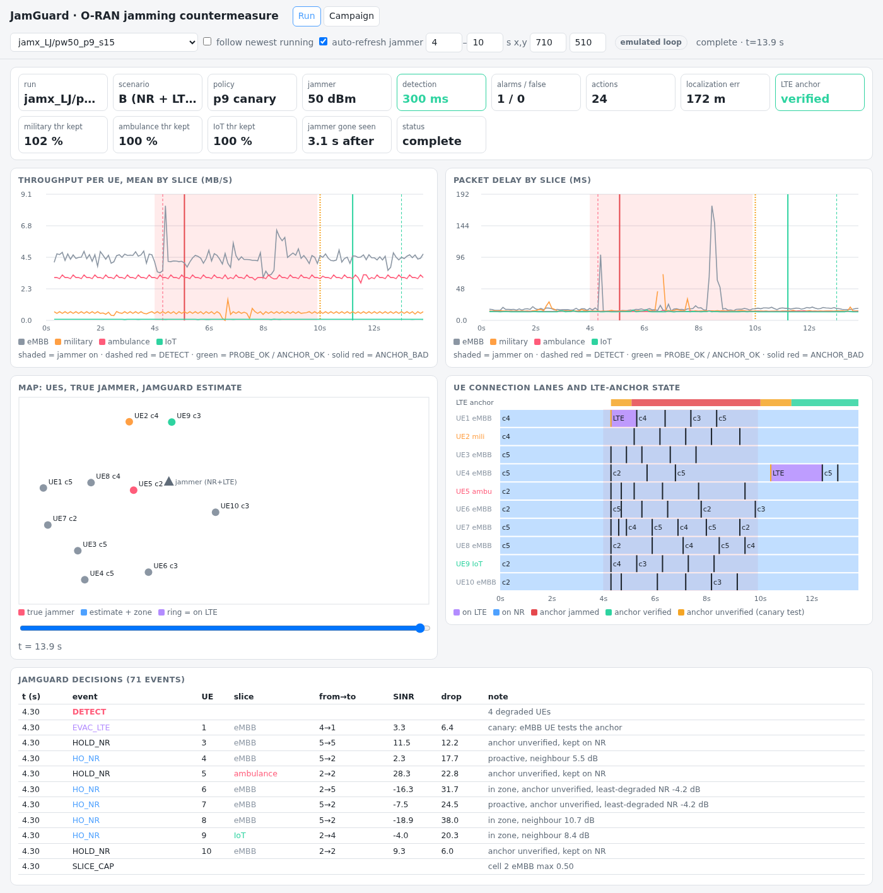

# JamGuard

Slice-aware closed-loop xApp for jamming detection, localization and mitigation in O-RAN,
running on FlexRIC and ns-O-RAN (ns-3 mmWave, EN-DC).

| folder | content |
|---|---|
| `xapp/` | FlexRIC xApp (C): detection, trilateration, mitigation, slicing, recovery |
| `ns3/scratch/` | EN-DC scenario with jammer, emulated RIC loop (`jamguard_local.h`), anchor-guard build |
| `patches/` | idempotent patch scripts applied to ns-O-RAN and FlexRIC (each keeps a `.bak_*` copy) |
| `scripts/` | campaign runner, live launcher, analysis and statistics |
| `results/` | campaign summaries and live-run logs |

Raw simulation output of every campaign in the paper is published as the GitHub release [dataset-v1](https://github.com/steveratti/jamguard-oran/releases/tag/dataset-v1) (one archive per campaign, SHA-256 checksums); [docs/DATASET.md](docs/DATASET.md) maps each archive to the section and table of the paper.
Licensing: see `docs/LICENSING.md`. The ns-3 parts are GPLv2 like the files they modify;
the xApp is subject to FlexRIC's licence terms.


## Paper
S. A. Ratti, A. Piccioni, W. Tiberti, C. Centofanti, F. Graziosi, D. Cassioli, A. Marotta, "JamGuard: A Slice-Aware Closed-Loop xApp for Jamming Detection, Localization, and Mitigation in O-RAN", submitted to IEEE Access, 2026.

Previous work (jammer detection and geolocation, offline): S. A. Ratti et al., "An O-RAN-Native xApp Framework for Jammer Detection and Geolocation", Sensors (MDPI), vol. 26, no. 21, art. 6859, 2026, doi:10.3390/s26216859 - dataset and code: https://github.com/steveratti/oran-jammer-detection-geolocation-dataset

## Dashboard



`scripts/jamguard_dash.py` is a local web dashboard (Python standard library only) for every run under `~/jamx*`:
per-slice throughput and delay, the map with the true jammer and JamGuard's estimate, the UE connection lanes,
the LTE-anchor state (canary test, `ANCHOR_BAD` / `ANCHOR_OK`) and the decision log. It reads emulated runs
(`jamguard_local.csv`) and live FlexRIC E2 runs (`jamguard_log.csv`), takes the jammer schedule from `jammer.txt`,
and refreshes running simulations every 2 s ("follow newest running" jumps to the newest one).

```bash
python3 scripts/jamguard_dash.py 8050      # then open http://localhost:8050
```
